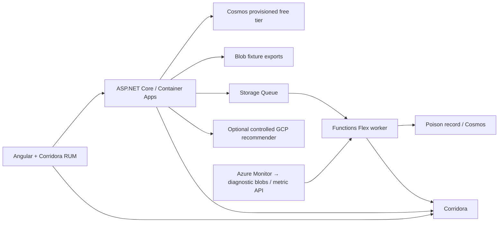

# Stride — Corridora fitness sample

Published 2026-10-11 · Updated 2026-10-11

A small, fictional workout log with Angular 22, ASP.NET Core/.NET 10, and an isolated .NET Azure Functions worker. Create a weekly summary and follow its browser request, Cosmos reads, Queue producer/consumer, bounded retries, poison evidence, and recovery in Corridora. Each checkout is independent and MIT licensed.



## Run locally

Install Python 3.11+, Node 26+, and .NET SDK 10. No Azure account, Docker, or second sample is required locally. The local store persists synthetic records in `.local/data`; the local bounded queue worker runs inside the API process.

```sh
./setup configure
./setup deploy
./setup run
```

Open <http://localhost:4104>. In another terminal run `./setup verify`. Setup downloads the pinned Chromium browser into the sample's Git-ignored `.local/browsers` cache when needed; `PLAYWRIGHT_CHROMIUM_EXECUTABLE_PATH` can reuse an installed browser. Linux hosts also need Playwright's documented OS libraries.

Bare `./setup` prompts, builds, starts the app, runs verification, and keeps the local server running until Ctrl-C. The first verification prepares Chromium automatically. Blank local Corridora keys disable export/RUM while retaining the functioning workflow. Set your own keys to see connected telemetry; maintained Demo keys come from an authorized operator. See [Set up Corridora](docs/corridora-setup.md) for each prompt and investigation steps.

## Workflow and daily incident

The Tempo run (`demo-workout`) is the deliberately incompatible fixture. At **14:00–14:10 UTC**, the effective simulated serializer revision becomes `serializer-v2-YYYYMMDD`. Every API handler and queue consumer independently checks the clock and any persisted finite override. A missed timer cannot leave the regression enabled. Only that workout's weekly summary is affected: its strict integer deserialization fails, retries at most three times, and becomes `poison`. Recovery walk (`healthy-workout`) remains healthy. No real user/fitness data is needed or sent to advertising vendors.

Queue envelopes include the producer's W3C `traceparent`/`tracestate`, release and expiry. The consumer explicitly extracts the parent, emits correlated logs/metrics, and flushes before success or retry. In Azure, the host moves exhausted messages to `weekly-summary-poison`; the poison consumer stores a durable diagnostic envelope in Cosmos. Replaying after recovery means submitting a new summary rather than repeatedly recycling a poison message. Cloud queue TTL is 15 minutes; local messages use a bounded channel of 50 items and are lost on process restart. Persisted jobs still expose their last state.

```sh
./setup scenario --phase regression --duration 120
./setup scenario --phase recover --duration 120
./setup verify
```

The scenario endpoint rejects empty/bad bearer tokens, unknown phases, and durations outside 1–600 seconds. A `recover`/`healthy` override temporarily suppresses the daily window. It expires independently, after which the normal UTC schedule applies. Regression metadata uses `demo.release`; `service.version` comes from the built assembly/source digest and is never replaced with a fake deployment version.

`synthetics/journey.mjs` drives real Angular buttons through healthy → poison → healthy control → recovery → automatic expiry. It records a daily heartbeat only after the whole browser journey succeeds. The optional Functions timer opens a bounded 30–120-second regression replay and enqueues the seeded action and healthy control at 14:01, so a short configured daily window or timer delay cannot silently skip the bad action. Its 14:20 watchdog opens a short replay if no browser heartbeat exists and exercises the bad backend action; it explicitly does **not** mark a browser pass. `.github/workflows/daily.yml` runs the full browser pass and a second watchdog replay at 14:30. GitHub schedules can be late, dropped, or disabled after 60 days of public-repository inactivity. A maintained deployment needs an operator to monitor missing heartbeats and run `python3 synthetics/daily.py --watchdog` on an existing runner within the UTC day. Local validation does not prove a hosted daily incident.

## Deploy to Azure

Expected incremental cost is **$0–2/month** under small demo traffic, an available Cosmos provisioned free tier, and shared subscription free grants. Cosmos serverless is not covered by the provisioned allowance. Public traffic, storage operations, diagnostic exports, image hosting or exhausted shared grants can exceed the estimate. There is no hard provider billing cap. Container Apps has 0–2 Consumption replicas, 0.25 CPU/0.5 GiB; Functions Flex uses 512 MiB, no Always Ready, queue batch size one, maximum dequeue three, and Azure's minimum configured maximum scale of 40 instances. Actual demo concurrency is constrained by the tiny queue workload, not a fabricated scale limit below Azure's supported minimum. Avoid ACR's recurring charge by using a **public GHCR image**.

Prerequisites: an Azure subscription, recent Azure CLI with an existing `az login` session, permission to deploy resources/assign roles, Docker Buildx with an existing GHCR push login, and a public GitHub package/repository. Operator runs Docker login separately; setup never prompts for account passwords or passes registry credentials in argv. New GHCR packages may default to private: make the pushed package public and rerun if setup's anonymous pull check fails. The first generated image is built and pushed by `deploy`; no unspecified prebuilt application image is required.

```sh
./setup configure              # choose cloud; collect scoped keys and Azure settings
./setup deploy --plan          # review subscription, region, resources and costs
./setup deploy                 # show account, approve concrete plan, build/push, apply Bicep, publish worker
./setup run                    # check deployed health and print URL
./setup verify                 # exercise the real public browser journey
./setup destroy --plan
./setup destroy
```

The script provisions actual resources from `infra/main.bicep`, publishes a Linux/amd64 API image and isolated Functions ZIP, seeds Cosmos lazily through the first workflow, and saves the deployed URL. A resource inventory and ownership tag allow resumable retries. A dedicated resource group is the default. Alternatively select an existing shared group and free-tier Cosmos account in that group: only the app-specific database, role assignments and diagnostic setting belong to this sample; the account and group survive teardown. Arbitrary preexisting Storage/Key Vault/Functions resources are not silently repurposed. Re-running deployment updates the recorded dedicated resources. See [Azure deployment details](docs/azure-deployment.md).

## Verify and contribute

Dependencies are pinned in `web/package-lock.json`, each .NET `packages.lock.json`, and the Functions SDK project version. Builds use locked restore. No credentials or outputs belong in Git. Use environment variables or a protected JSON `--config` for noninteractive setup; `.env.example` documents names without storing credentials. `./setup --help` needs only Python.

```sh
python3 -m unittest discover -s tests -p 'test_*.py' -v
# Export DOTNET_CLI_HOME/NUGET_PACKAGES under .local in a restricted environment, if needed.
dotnet run --project tests/Fitness.Tests/Fitness.Tests.csproj
dotnet build src/Fitness.Api/Fitness.Api.csproj -p:RestoreLockedMode=true
dotnet build src/Fitness.Worker/Fitness.Worker.csproj -p:RestoreLockedMode=true
cd web && npm ci --ignore-scripts && npm run build
cd ..
python3 tests/integration.py
```

The integration suite launches a local OTLP capture server with mock keys. It decodes actual .NET SDK OTLP protobuf, validates auth and parentage, tests poison/control/expiry/recovery, and never contacts shared Demo. Set `RUM_BUNDLE_PATH` to a genuine Corridora RUM distribution to additionally route its CDN download locally and prove a browser CLIENT is the actual parent of a captured SERVER span. Set `PLAYWRIGHT_CHROMIUM_EXECUTABLE_PATH` only to reuse an installed browser. Without the real distribution the correlation-specific browser test is explicitly skipped. `./setup verify` exercises the browser and gives trace IDs; stored Corridora evidence still requires your scoped query access or UI inspection.

Useful routes: `/healthz`, `/api/trace-check`, `/api/demo/status`, `/api/workouts`, `/api/recommendations`, `/api/export`, `POST /api/summaries`, and `/api/summaries/{id}`. API/control responses are noncached. `RECOMMENDER_URL` is an optional controlled HTTPS **base origin** implementing `/api/recommendations?product_id=demo-product`; an empty value supplies a deterministic local fixture. Redirects are disabled, timeout is three seconds, and only dedicated optional dependency auth plus trace metadata goes downstream.
